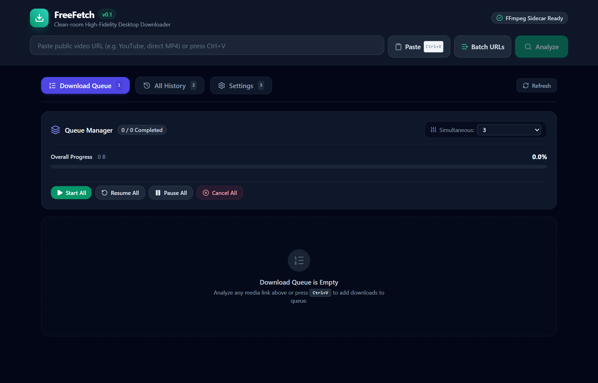
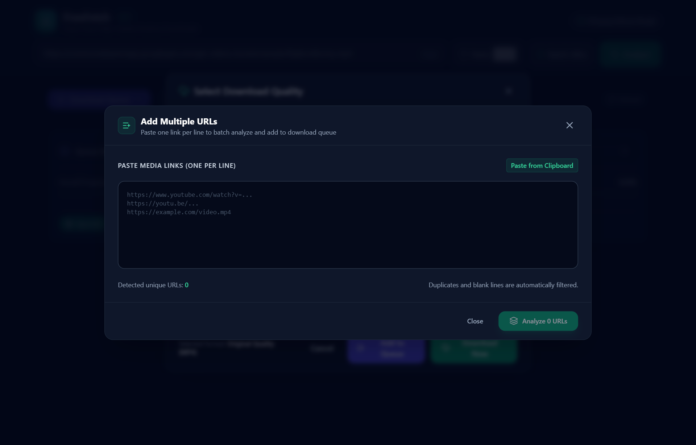
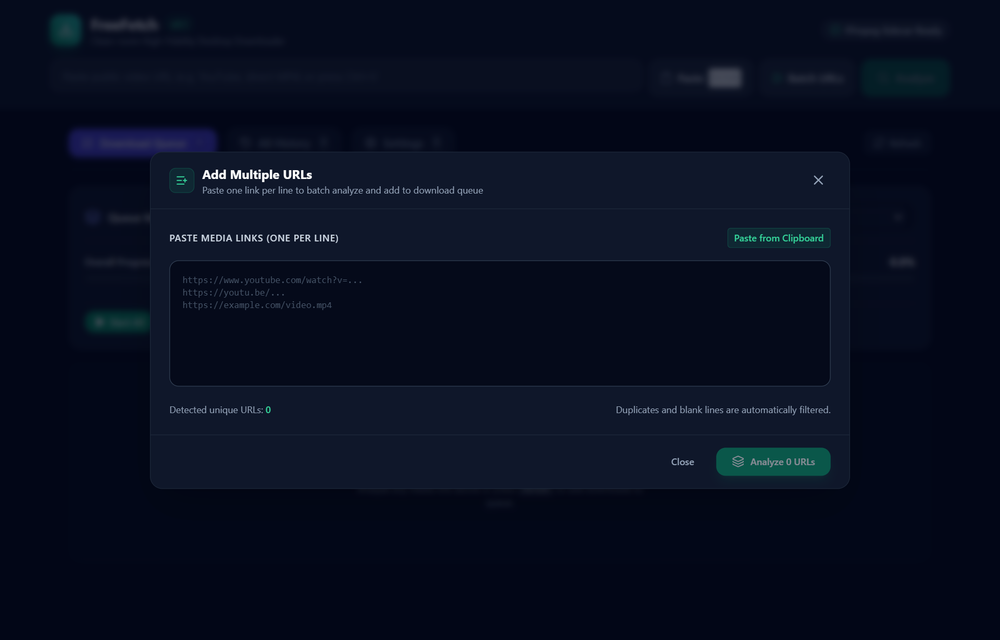
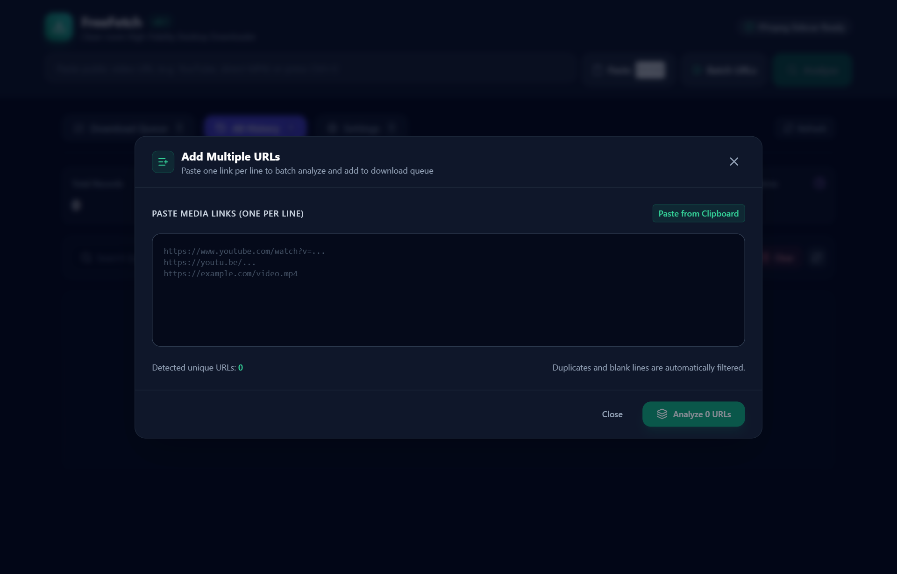
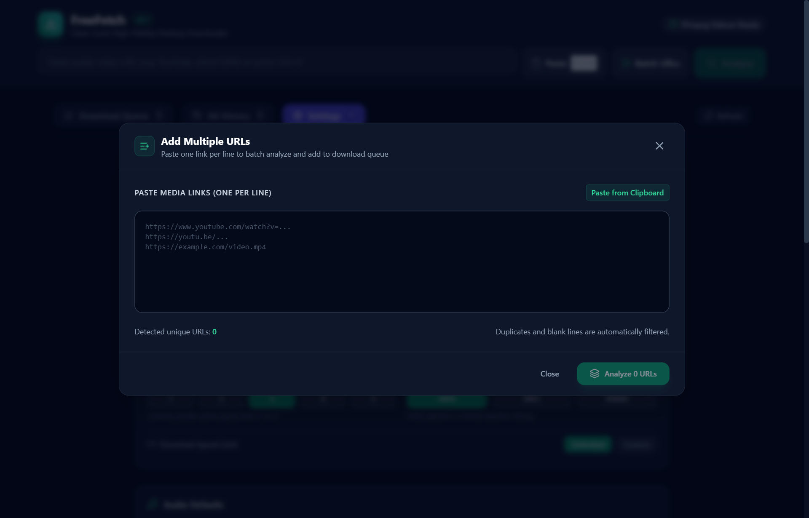
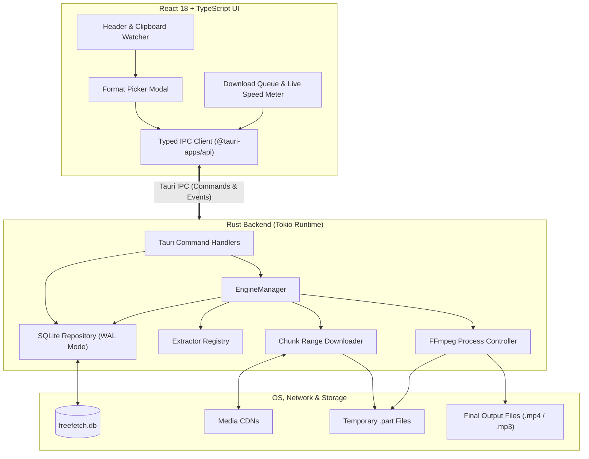

# FreeFetch

> Clean-room, high-fidelity desktop media downloader built with Tauri v2, Rust, React, and FFmpeg.

[](https://github.com/risterz/FreeFetch/releases)
[](LICENSE)
[](docs/DOCUMENTATION.md)
[](https://www.rust-lang.org/)
[](https://v2.tauri.app/)

---

## Visual Tour & Real UI Screenshots

| Main Queue Dashboard | Stream Format Picker Modal |
| :---: | :---: |
|  |  |

| Batch / Multi-URL Downloader | SQLite History & Metrics |
| :---: | :---: |
|  |  |

| Application & Engine Settings |
| :---: |
|  |

> 📖 **Full Technical Documentation**: For detailed architecture, extractor internals, and security designs, consult [docs/DOCUMENTATION.md](docs/DOCUMENTATION.md).

---

## 1. Project Overview

FreeFetch is an open-source, modern desktop media downloader engineered for high performance, reliability, and security without bloat, background telemetry, or adware. It implements a clean-room architecture separating network extraction, segmented HTTP range downloading, and multimedia remuxing.

### Key Capabilities (v0.1 MVP)
- **Tauri v2 Desktop App**: Native OS integration with WebView2, compact binary footprint, and low memory usage.
- **Single-Video Media Extraction**: Clean-room extraction supporting public video URLs (e.g., YouTube public watch/shorts/oEmbed, direct MP4/WebM/MKV links, and HTML5 OpenGraph media).
- **Quality & Format Selection**: User-selectable video streams (1080p FHD, 720p HD, 480p, 360p) and pure audio extraction (MP3 320 kbps, M4A).
- **Segmented Range Downloader**: HTTP/HTTPS streaming with `Range` requests, resumable `.part` temporary chunk management, real-time speed calculation, and ETA metrics.
- **FFmpeg Multiplexing (Remuxing)**: Seamless stream merging for adaptive video feeds and pure audio transcoding using structured external process invocation.
- **Embedded SQLite Persistence**: Resilient local database (`freefetch.db`) storing download history, progress state, and crash recovery.
- **OS Native Integrations**: Clipboard URL detection, direct media opening, and "Open Containing Folder" in Windows Explorer.

---

## 2. Architecture

FreeFetch is built on a decoupled, multi-tier desktop architecture:



### Module Separation (`src-tauri/src/`)
- `core/`: Common error definitions (`FreeFetchError`), domain types (`DownloadRecord`, `DownloadStatus`), and application settings (`AppSettings`).
- `storage/`: Embedded SQLite connection manager, WAL mode migrations, and parameterized CRUD repository.
- `extractor/`: Extensible `Extractor` trait and registry with implementations for `youtube` (public oEmbed/metadata) and `generic` (direct links & OpenGraph).
- `engine/`: Resumable chunk downloader, rate limiter, safe filename sanitization, and download lifecycle management.
- `media/`: Sidecar FFmpeg/FFprobe controller for lossless merging and transcoding.
- `service/`: Clipboard detection and helper routines.
- `ipc/`: Typed Tauri commands (`parse_url`, `start_download`, `pause_download`, `resume_download`, `delete_download`, `open_downloaded_file`, etc.) and events.

---

## 3. Development Setup & Prerequisites

### Prerequisites
- **Operating System**: Windows 10/11 x64, macOS 11+, or Linux x64
- **Node.js**: v18 or later (tested on v24.x)
- **Rust Toolchain**: Rust 1.77+ with Cargo (MSVC toolchain on Windows)
- **FFmpeg**: FFmpeg 5.x+ and FFprobe in system PATH or placed in sidecars folder

### Environment Setup Commands

#### 1. Rust Setup (Windows)
If Rust is not yet installed:
```powershell
winget install --id Rustlang.Rustup -e
rustup default stable-x86_64-pc-windows-msvc
```

#### 2. Node Dependencies
Install frontend and Tauri CLI dependencies:
```bash
npm install
```

#### 3. FFmpeg Verification
Verify FFmpeg is reachable on your terminal:
```bash
ffmpeg -version
ffprobe -version
```
FreeFetch automatically discovers FFmpeg from:
1. Custom user setting path
2. `src-tauri/sidecars/` or next to executable
3. Chocolatey installation directory (`C:\ProgramData\chocolatey\bin\ffmpeg.exe`)
4. System `PATH`

---

## 4. Development & Build Commands

| Task | Command | Description |
| :--- | :--- | :--- |
| **Launch FreeFetch (Dev)** | `npm run tauri dev` | Starts Vite dev server and launches desktop Tauri window with hot reload |
| **Frontend Dev Server** | `npm run dev` | Runs Vite web client standalone on `http://localhost:1420` |
| **Frontend Typecheck & Build** | `npm run build` | Compiles TypeScript and builds production web bundle to `dist/` |
| **Run Frontend Tests** | `npm test` | Executes Vitest test suite |
| **Run Rust Tests** | `cargo test --manifest-path src-tauri/Cargo.toml` | Executes Rust unit tests for parser, sanitization, SQLite, and state |
| **Rust Typecheck** | `cargo check --manifest-path src-tauri/Cargo.toml` | Fast compilation check of the Rust backend |
| **Production Windows Build** | `npm run tauri build` | Produces optimized, signed Windows `.exe` and `.msi` installers |

---

## 5. Project Structure

```
FreeFetch/
├── package.json                 # Frontend dependencies and npm scripts
├── tsconfig.json                # TypeScript compiler configuration
├── vite.config.ts               # Vite configuration (port 1420)
├── tailwind.config.js           # Tailwind CSS theme configuration
├── index.html                   # Desktop app HTML entrypoint
├── src/                         # Frontend React 18 application
│   ├── main.tsx                 # React DOM bootstrap
│   ├── App.tsx                  # Main FreeFetch application shell
│   ├── index.css                # Global styling & custom scrollbars
│   ├── api/
│   │   ├── types.ts             # Mirrored TypeScript data models
│   │   └── ipc.ts               # Typed Tauri invoke & event abstractions
│   └── components/
│       ├── common/ProgressBar.tsx
│       ├── layout/Header.tsx
│       ├── modal/FormatModal.tsx
│       └── queue/
│           ├── DownloadCard.tsx
│           └── FilterTabs.tsx
├── tests/
│   └── frontend.test.ts         # Vitest unit test suite
└── src-tauri/                   # Rust backend (Tauri v2)
    ├── Cargo.toml               # Cargo dependencies and workspace config
    ├── tauri.conf.json          # Tauri v2 window and security settings
    ├── capabilities/
    │   └── default.json         # Tauri v2 desktop permission capabilities
    ├── icons/                   # Application icon assets (.ico, .png)
    ├── tests/
    │   └── unit_tests.rs        # Rust integration and unit test suite
    └── src/
        ├── main.rs              # Application entrypoint
        ├── lib.rs               # Library bootstrap & Tauri handler registration
        ├── core/                # Configuration, errors, and domain types
        ├── storage/             # SQLite migrations and repository
        ├── extractor/           # Extractor trait, registry, YouTube & Generic
        ├── engine/              # Range downloader, rate limiter, state machine
        ├── media/               # FFmpeg process controller & probe analyzer
        ├── service/             # Clipboard inspection service
        └── ipc/                 # Command handlers and event definitions
```

---

## 6. Security Considerations

1. **Strict Process Isolation**:
   - FreeFetch never constructs shell strings (`cmd.exe /C` or `sh -c`).
   - All invocations to FFmpeg, Explorer, and system launchers pass arguments as individual immutable slices (`std::process::Command::arg`).
2. **Filename & Path Sanitization**:
   - Filenames from remote media titles are stripped of reserved filesystem characters (`< > : " / \ | ? *`) and control characters, bounded to 180 characters, and protected against path traversal (`../`).
3. **SSRF & URL Verification**:
   - The engine validates all URLs, strictly permitting only `http://` and `https://` schemes. Local filesystem schemes (`file://`) and arbitrary protocols are rejected.
4. **Content Security Policy (CSP)**:
   - Tauri is hardened with strict CSP blocking unauthorized scripts, style evaluations, and remote frames.
5. **Privacy & Credentials**:
   - FreeFetch does not log user credentials, tokens, or private metadata.

---

## 7. Clean-Room Implementation Statement

FreeFetch was designed and authored strictly as a clean-room implementation following public specifications and standard media protocols. No proprietary source code, proprietary binaries, or reverse-engineered code from closed-source tools was copied into this codebase. FreeFetch does not implement DRM bypass, payment bypass, authentication bypass, or private credential harvesting.

---

## 8. Installation, Dependencies & Updates

### Windows Installation
FreeFetch release installers bundle verified standalone x86_64 sidecars for both **FFmpeg** and **yt-dlp** in `sidecars/`, enabling immediate operation on clean Windows installations without requiring developer tools, Chocolatey, Scoop, or Python.

1. Download `FreeFetch_0.1.0_x64-setup.exe` (NSIS) or `FreeFetch_0.1.0_x64_en-US.msi` (MSI).
2. Run the installer:
   - **NSIS Setup**: Double-click to install per-user (no admin rights required).
   - **MSI Installer (Per-User)**: Run `msiexec.exe /i FreeFetch_0.1.0_x64_en-US.msi MSIINSTALLPERUSER=1 ALLUSERS=2 /qn /norestart`.
3. Launch FreeFetch from the Desktop or Start Menu.

### Code Signing & SmartScreen (Public Beta)
- **Status**: The public beta binary release is **unsigned** (Open Source Preview).
- **Windows SmartScreen**: When launching the installer, Windows SmartScreen may display: *"Windows protected your PC / Unknown Publisher"*. Click **"More info"**, then select **"Run anyway"**.
- **Cryptographic Verification**: Official SHA-256 checksums are published in every release note. Verify your installer via PowerShell:
  ```powershell
  Get-FileHash -Path "FreeFetch_0.1.0_x64-setup.exe" -Algorithm SHA256
  ```

### Updates
- **Application Updates**: Manual in-place updates. Download newer installers from official GitHub Releases (`https://github.com/risterz/FreeFetch/releases`) and run over existing installation; local settings and history database (`freefetch.db`) are preserved automatically.
- **yt-dlp Self-Updating**: Because media platforms frequently adjust delivery protocols, users can update `yt-dlp` directly inside FreeFetch via **Settings > Advanced > Update yt-dlp** without requiring an entire app upgrade.

---

## 9. Licensing & Third-Party Notices

FreeFetch application source code is licensed under the [MIT License](LICENSE).

Bundled binaries and external dependencies are distributed in strict accordance with their respective upstream licenses:
- **FFmpeg (`ffmpeg.exe`)**: GNU General Public License v3.0 (GPLv3). Source code is available at [https://ffmpeg.org](https://ffmpeg.org).
- **yt-dlp (`yt-dlp.exe`)**: The Unlicense (Public Domain Dedication). Upstream at [https://github.com/yt-dlp/yt-dlp](https://github.com/yt-dlp/yt-dlp).

See [THIRD_PARTY_LICENSES.md](THIRD_PARTY_LICENSES.md) for full licensing details, compilation configurations, and third-party notices.

