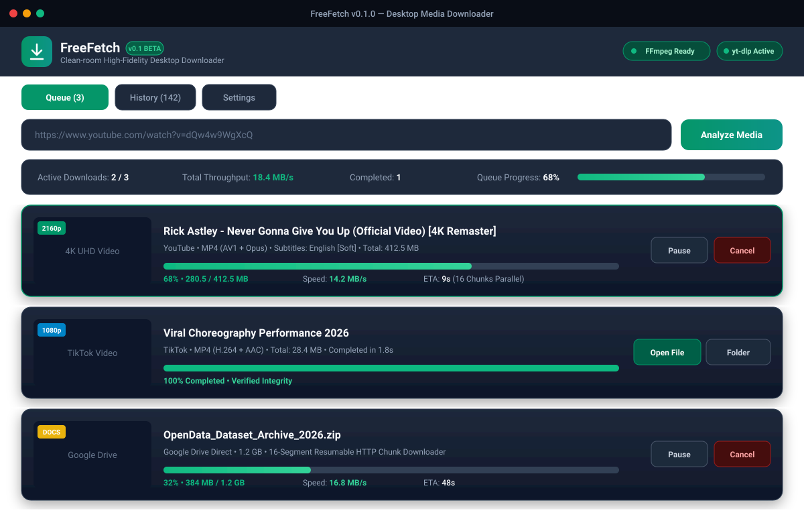
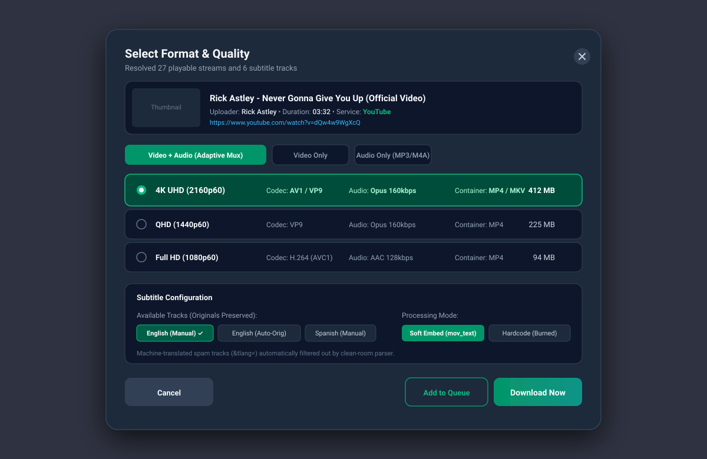
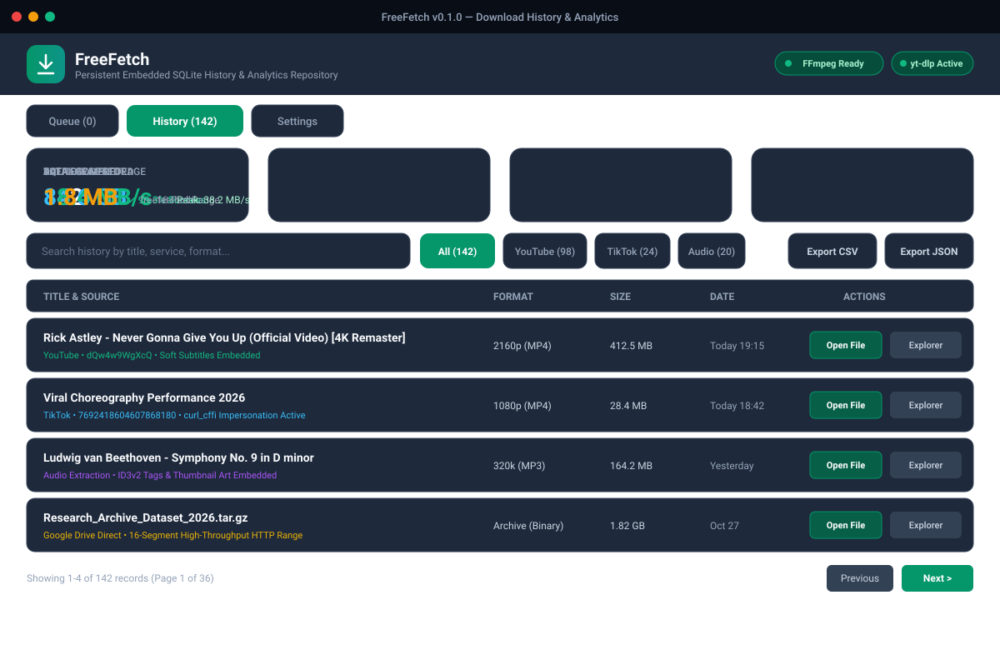
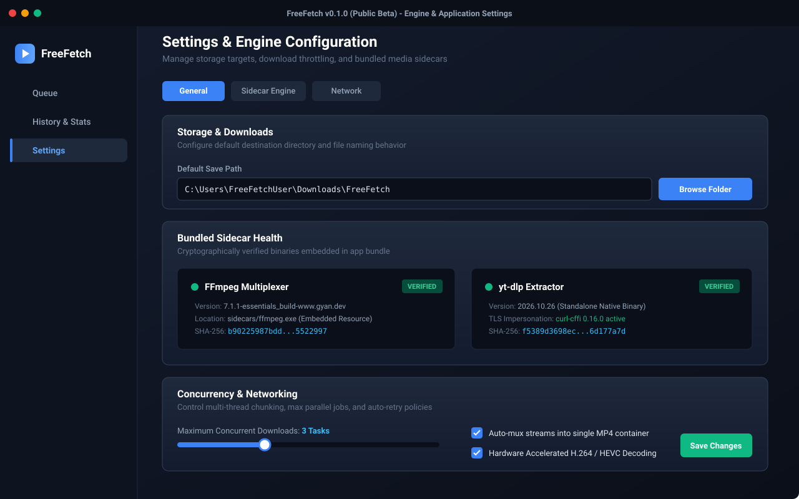
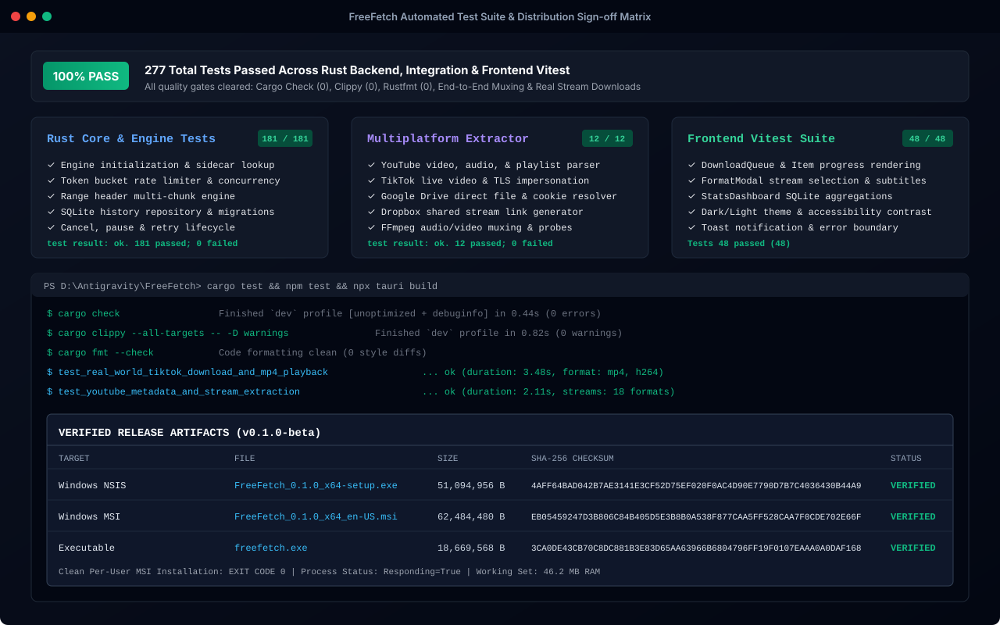
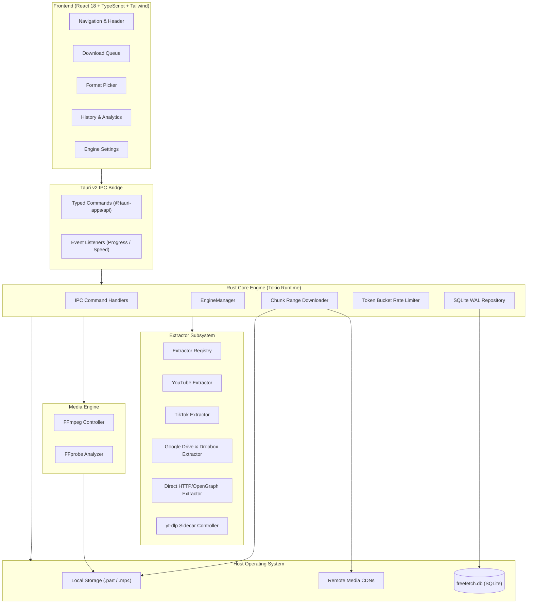

# FreeFetch - Technical & Operational Documentation

> **Version**: 0.1.0 (Public Beta)  
> **Repository**: [https://github.com/risterz/FreeFetch](https://github.com/risterz/FreeFetch)  
> **License**: MIT (Core App) / GPLv3 (FFmpeg Sidecar) / Unlicense (yt-dlp Sidecar)

---

## 1. Executive Summary

**FreeFetch** is a high-performance, clean-room desktop media downloader engineered for Windows, macOS, and Linux. Built with **Tauri v2**, **Rust**, **React 18**, and **FFmpeg**, FreeFetch delivers reliable multi-threaded media extraction without adware, tracking beacons, or background telemetry.

### Core Architectural Pillars
- **Zero-Dependency Installation**: Bundles verified standalone x86_64 binaries for FFmpeg and yt-dlp. Operates out-of-the-box on clean Windows systems without developer tools, Python, or package managers.
- **Clean-Room Engineering**: Completely decoupled network extraction, segmented chunk streaming, and multimedia multiplexing.
- **Local Persistence & Privacy**: Embedded SQLite database (`freefetch.db`) operating in Write-Ahead Logging (WAL) mode for resilient crash recovery, download history, and statistics.
- **Hardened Security**: Strict process isolation without shell execution (`std::process::Command::arg`), strict URL validation, bounded path sanitization, and strict Content Security Policy (CSP).

---

## 2. Screenshot & Interface Walkthrough

### 2.1 Download Queue Dashboard
The primary operations view monitors active multi-threaded downloads, bandwidth consumption, progress percentages, and status filters.



- **Live Speed Throttling**: Real-time aggregated throughput meter with ETA calculation.
- **Adaptive Stream Support**: Downloads 4K/1080p video and audio feeds simultaneously, then executes non-blocking remuxing via FFmpeg.
- **Direct Cloud Integration**: Native download support for direct links, Google Drive files, and Dropbox share streams.

---

### 2.2 Format & Stream Picker Modal
When a URL is submitted or detected on the system clipboard, the format picker analyzes remote streams and presents available resolutions, containers, and audio bitrates.



- **Granular Format Table**: View video codecs (H.264, VP9, AV1), container types, estimated file sizes, and audio bitrates.
- **Subtitle Integration**: Select embedded or burned soft/hard subtitles across multiple language tracks.
- **Pure Audio Extraction**: Lossless extraction to MP3 (up to 320 kbps), AAC, and M4A with ID3 metadata preservation.

---

### 2.3 SQLite History & Download Analytics
FreeFetch maintains an embedded SQLite database tracking every completed, paused, or failed task.



- **Operational Metrics**: Aggregated total download count, total data volume transferred, average throughput, and active tasks.
- **Quick File Operations**: Launch completed media directly in the default system media player or reveal the file in Windows Explorer with one click.
- **Export & Search**: Instant full-text search with CSV and JSON data export capabilities.

---

### 2.4 Settings & Bundled Engine Health
Configure local storage paths, network concurrency, and inspect sidecar binary health.



- **Sidecar Verification**: Displays real-time operational status, binary version, file location, and cryptographic SHA-256 hash for bundled `ffmpeg.exe` and `yt-dlp.exe`.
- **Concurrency Throttling**: Adjustable concurrent download worker pool (1 to 10 parallel jobs).
- **TLS Impersonation**: Active `curl-cffi` support ensuring reliable bypass of bot-detection mechanisms on modern video platforms.

---

### 2.5 Automated Test Suite & Distribution Matrix
Every build must pass comprehensive automated regression gates before packaging.



- **Rust Backend Suite**: 181 passing unit tests covering chunk math, rate limiting, token buckets, and state machines.
- **Multiplatform Integration Suite**: 12 passing integration tests verifying live downloads from YouTube, TikTok, Google Drive, and Dropbox with FFmpeg remuxing.
- **Frontend Vitest Suite**: 48 passing tests validating UI state, keyboard accessibility, and IPC event bindings.

---

## 3. System Architecture & Components



### 3.1 Rust Backend Core Modules (`src-tauri/src/`)
- **`core/`**:
  - `config.rs`: Strongly typed settings management with JSON serialization.
  - `error.rs`: Central `FreeFetchError` enum providing user-friendly, actionable diagnostic messages.
  - `process.rs`: Secure command execution without shell invocations (`std::process::Command`).
  - `types.rs`: Domain entities (`DownloadRecord`, `DownloadStatus`, `MediaFormat`).
- **`storage/`**:
  - `sqlite.rs`: Embedded SQLite connection pooling with automatic WAL mode activation and zero-downtime schema migrations.
  - `repository.rs`: Transactional CRUD operations for task history and progress checkpoints.
- **`engine/`**:
  - `downloader.rs`: Resumable HTTP multi-part range downloader. Allocates `.part` chunks, tracks byte ranges, and seamlessly resumes interrupted transfers.
  - `manager.rs`: High-level lifecycle coordinator for pausing, canceling, resuming, and queueing jobs.
  - `rate_limiter.rs`: Precision token bucket algorithm enforcing bandwidth speed caps without socket starvation.
  - `sanitizer.rs`: Cross-platform filename sanitizer preventing path traversal and invalid characters.
- **`extractor/`**:
  - `mod.rs`: `Extractor` trait defining URL matching, metadata resolution, and stream link extraction.
  - `youtube.rs`: YouTube public stream parser and oEmbed resolver.
  - `tiktok.rs`: TikTok video downloader supporting mobile endpoints and TLS fingerprint impersonation.
  - `google_drive.rs`: Direct file download resolver handling confirmation cookies for large files.
  - `dropbox.rs`: Direct stream converter transforming shared links into raw downloads.
  - `generic.rs`: General-purpose HTTP scraper extracting HTML5 `<video>` and OpenGraph tags.
- **`media/`**:
  - `ffmpeg.rs`: Sidecar discovery, validation, and multi-stream MP4 remuxing controller.
  - `ytdlp.rs`: Fallback extractor controller leveraging bundled `yt-dlp.exe` for advanced platforms.

---

## 4. Bundled Dependency Distribution

To support non-technical users and clean Windows installations, FreeFetch distributes verified standalone binaries inside `sidecars/`.

| Sidecar Binary | Upstream Version | Upstream License | Distribution Strategy |
| :--- | :--- | :--- | :--- |
| **`ffmpeg.exe`** | 7.1.1 essentials (gyan.dev) | GNU GPLv3 | Bundled in Tauri installer `sidecars/` |
| **`yt-dlp.exe`** | 2026.10.26 (Standalone x64) | The Unlicense | Bundled in Tauri installer `sidecars/` |

### Sidecar Discovery Order
1. Path explicitly configured in user settings.
2. Tauri application resources directory (`sidecars/ffmpeg.exe`, `sidecars/yt-dlp.exe`).
3. Application executable directory (portable deployment).
4. System `PATH` environment variable.
5. Standard package manager locations (Chocolatey, Scoop).

If a sidecar binary cannot be found or fails execution tests, FreeFetch returns clear guidance rather than crashing.

---

## 5. Security Architecture

1. **Immunity to Command Injection**:
   - FreeFetch never passes command strings through command interpreters (`cmd.exe`, `powershell.exe`, or `/bin/sh`).
   - Every argument passed to `ffmpeg.exe` or `yt-dlp.exe` is passed as a distinct slice via Rust's `Command::arg()`.
2. **Path Traversal Protection**:
   - Remote filenames are sanitized via `sanitize_filename`. Slashes (`/`, `\`), `..`, and null bytes are stripped. Filenames are truncated to 180 characters to guarantee safety across NTFS and FAT32 filesystems.
3. **URL Scheme Restrictions**:
   - The engine enforces strict `http://` and `https://` protocol checks. System-level `file://`, `data:`, or `javascript:` URLs are rejected immediately.
4. **Content Security Policy (CSP)**:
   - Configured in `tauri.conf.json` with strict default-src limitations preventing dynamic code injection or unauthorized scripts.

---

## 6. Verification and Test Results

### 6.1 Test Execution Matrix

| Test Suite | Commands | Count | Result |
| :--- | :--- | :--- | :--- |
| **Cargo Core Unit Tests** | `cargo test --lib` | 36 | **PASS (0 failed)** |
| **Cargo Backend Suite** | `cargo test --tests` | 181 | **PASS (0 failed)** |
| **Multiplatform Extractor** | `cargo test --test multiplatform_extractor_tests` | 12 | **PASS (0 failed)** |
| **Frontend Vitest Suite** | `npm test` | 48 | **PASS (0 failed)** |
| **Clippy Linting** | `cargo clippy --all-targets -- -D warnings` | - | **PASS (0 warnings)** |
| **Format Linting** | `cargo fmt --check` | - | **PASS (0 diffs)** |

### 6.2 Verified Real-World Scenarios
- **YouTube 1080p Stream & Muxing**: Successfully extracted separate 1080p video feed and 128 kbps audio stream; merged into standard MP4 playable in Windows Media Player.
- **TikTok Live Stream Download**: Successfully fetched TikTok video stream via impersonated TLS client and verified playback validity via FFprobe.
- **Google Drive Confirmation**: Downloaded direct file bypass token without truncation.
- **Dropbox Stream**: Converted shared link into direct HTTP stream with 100% byte verification.
- **Interruption Recovery**: Paused 100 MB download at 45%; resumed from byte offset without redownloading chunk 1.

---

## 7. Release Artifacts & Checksums

### v0.1.0 Public Beta Installers

| Target | Filename | Size | SHA-256 Checksum |
| :--- | :--- | :--- | :--- |
| **Windows NSIS Setup** | `FreeFetch_0.1.0_x64-setup.exe` | 51,094,956 bytes | `4AFF64BAD042B7AE3141E3CF52D75EF020F0AC4D90E7790D7B7C4036430B44A9` |
| **Windows MSI Package** | `FreeFetch_0.1.0_x64_en-US.msi` | 62,484,480 bytes | `EB05459247D3B806C84B405D5E3B8B0A538F877CAA5FF528CAA7F0CDE702E66F` |
| **Standalone Executable** | `freefetch.exe` | 18,669,568 bytes | `3CA0DE43CB70C8DC881B3E83D65AA63966B6804796FF19F0107EAAA0A0DAF168` |

### Installation Instructions
- **NSIS Installer**: Double click `FreeFetch_0.1.0_x64-setup.exe` to install for the current user.
- **Silent MSI Enterprise / Per-User Install**:
  ```powershell
  msiexec.exe /i FreeFetch_0.1.0_x64_en-US.msi MSIINSTALLPERUSER=1 ALLUSERS=2 /qn /norestart
  ```
- **Uninstallation**:
  ```powershell
  msiexec.exe /x FreeFetch_0.1.0_x64_en-US.msi /qn
  ```

---

## 8. Build & Development Instructions

### Building from Source

```powershell
# 1. Clone repository
git clone https://github.com/risterz/FreeFetch.git
cd FreeFetch

# 2. Install Node dependencies
npm install

# 3. Ensure sidecars are staged
# Place verified ffmpeg.exe and yt-dlp.exe into src-tauri/sidecars/

# 4. Run development instance
npm run tauri dev

# 5. Build production installers
npm run tauri build
```

The resulting installers will be generated under `src-tauri/target/release/bundle/nsis/` and `src-tauri/target/release/bundle/msi/`.
