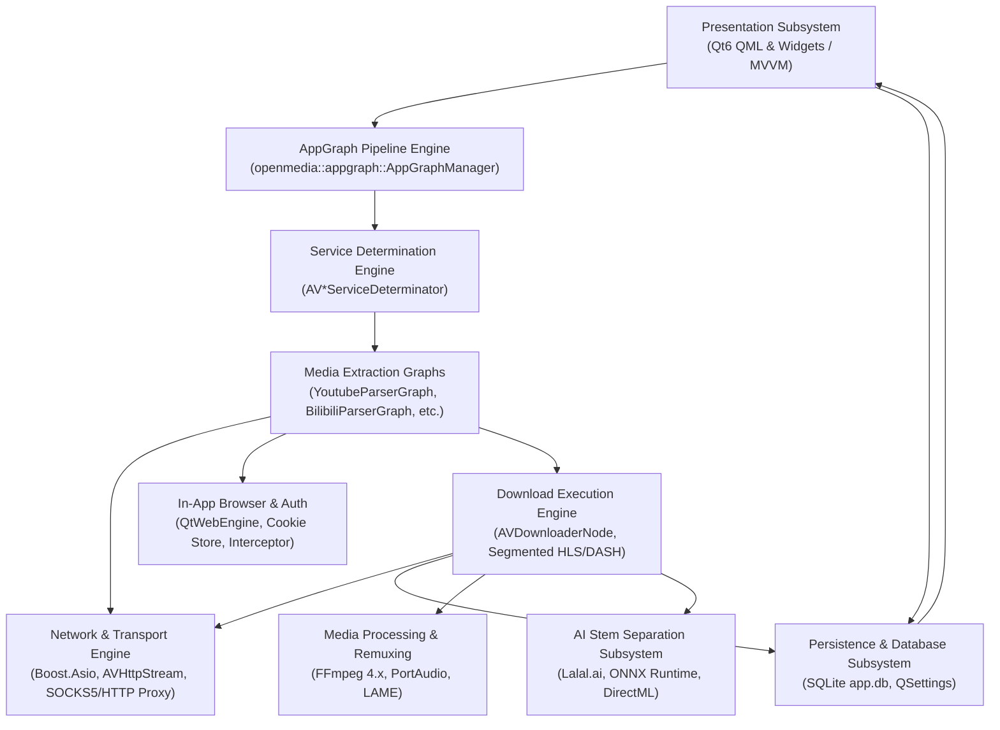
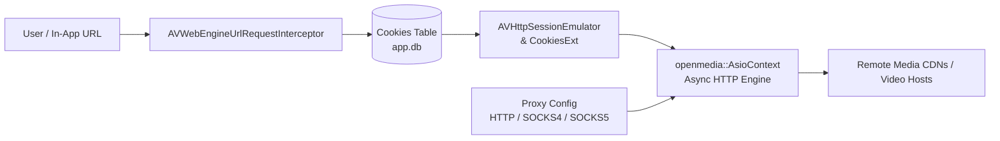
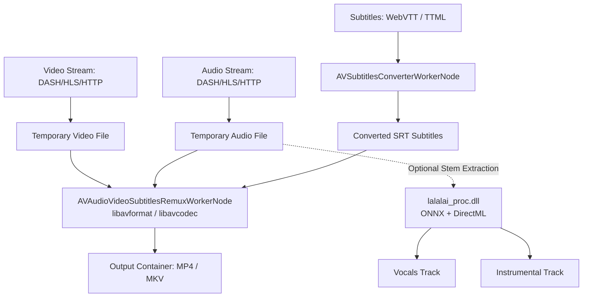
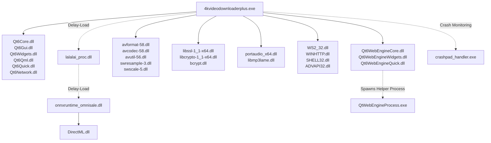
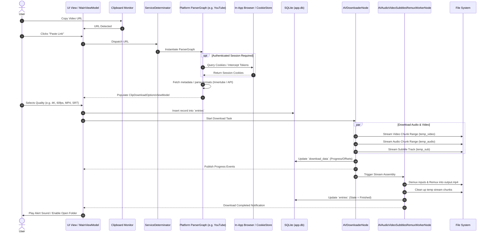

# Static Reconnaissance Report: 4K Video Downloader+ Reference Architecture
**Target Application**: `4K Video Downloader+` (v26.3.5.0396)  
**Reference Directory**: `D:\Antigravity\rea\4kvideodownloaderplus`  
**Purpose**: Clean-room technical specification and architectural blueprint for independent implementation of **FreeFetch**.  
**Execution Boundary**: Strict static analysis only. No target binaries executed, modified, patched, or cracked. DRM, licensing, and authentication bypasses explicitly excluded.

---

## 1. Directory Inventory Summary

| Metric | Observable Value | Details |
| :--- | :--- | :--- |
| **Total Files** | **1,993 files** | Full recursive directory walk |
| **Total Disk Size** | **~632.4 MB** | Combined binary, data, and asset payload |
| **Executable Binaries** | **3 files (.exe)** | Main app, Chromium worker, Crashpad reporter |
| **Dynamic Libraries** | **156 files (.dll)** | Qt6 runtimes, FFmpeg, OpenSSL, ONNX, PortAudio, plugins |
| **QML Script Files** | **754 files (.qml)** | Qt Quick UI components and styles |
| **QML Meta/Directives** | **53 `qmldir` files, 45 `.qmltypes`** | QML module manifests and type exports |
| **Binary Assets** | **57 `.pak`, 1 `.dat`, 1 `.bin`** | Chromium / QtWebEngine resources, ICU data, V8 snapshot |
| **Graphics Assets** | **915 `.png` files** | UI icons, vector rasters, control skins |
| **Audio Assets** | **2 files (`alert.mp3`, `alert.wav`)** | Notification audio cues for completion/events |
| **Document / Config** | **7 `.txt`, 1 `.rtf`** | License texts (EULA, LGPL 2.1, LGPL 3.0), third-party notices, Conan build manifests |

### Key Subdirectories
* `audio/`: Notification sound files (`alert.mp3`, `alert.wav`).
* `platforms/`: Qt platform plugin (`qwindows.dll`).
* `imageformats/`: Qt image decoding plugins (`qico.dll`, `qjpeg.dll`, `qsvg.dll`, `qwebp.dll`).
* `networkinformation/`: Qt network interface polling plugin (`qnetworklistmanager.dll`).
* `tls/`: Qt TLS backend modules (`qcertonlybackend.dll`, `qopensslbackend.dll`, `qschannelbackend.dll`).
* `styles/`: Qt native styling plugins (`qmodernwindowsstyle.dll`, `qwindowsvistastyle.dll`).
* `QtWebEngine/`, `qtwebengine_locales/`: Chromium web engine resources and 57 localization packs.
* `QtQuick/`, `QtQuick.2/`, `QtQml/`, `Qt5Compat/`, `QtGraphicalEffects/`: Qt Quick Controls and UI shaders.

---

## 2. Inventory of Binaries (EXEs and DLLs)

### 2.1 Executables (3)
1. `4kvideodownloaderplus.exe` (171.01 MB, 179,314,432 bytes) — Primary application executable.
2. `QtWebEngineProcess.exe` (634.3 KB) — Chromium isolated multi-process web rendering worker.
3. `crashpad_handler.exe` (786.3 KB) — Chromium Crashpad crash reporter process.

### 2.2 Key Dynamic Libraries (156 DLLs grouped by domain)

| Domain | Binaries | Upstream Source / Technology |
| :--- | :--- | :--- |
| **Multimedia Processing** | `avcodec-58.dll`, `avformat-58.dll`, `avutil-56.dll`, `postproc-55.dll`, `swresample-3.dll`, `swscale-5.dll` | FFmpeg 4.x (LGPL v2.1) |
| **Audio Codec & Playback** | `libmp3lame.dll`, `portaudio_x64.dll` | LAME MP3 Encoder, PortAudio Real-Time Audio Engine |
| **AI Audio Processing** | `lalalai_proc.dll`, `onnxruntime_omnisale.dll`, `DirectML.dll` | Lalal.ai Stem Separator, Microsoft ONNX Runtime + DirectML |
| **Cryptography & TLS** | `libcrypto-1_1-x64.dll`, `libssl-1_1-x64.dll` | OpenSSL 1.1.1 (OpenSSL License) |
| **Image Processing** | `imagequant.dll`, `libexif-12.dll` | Libimagequant (PNG optimization), Libexif |
| **Graphics & Rendering** | `d3dcompiler_47.dll`, `libEGL.dll`, `libGLESv2.dll`, `opengl32sw.dll` | ANGLE (DirectX to OpenGL ES), Mesa Software OpenGL |
| **Core UI Framework** | `Qt6Core.dll`, `Qt6Gui.dll`, `Qt6Widgets.dll`, `Qt6Qml.dll`, `Qt6Quick.dll`, `Qt6WebEngineCore.dll`, `Qt6WebEngineWidgets.dll`, `Qt6Network.dll`, `Qt6Xml.dll` | Qt 6.x (The Qt Company / LGPL v3.0) |
| **C/C++ Runtimes** | `msvcp140.dll`, `msvcp140_1.dll`, `msvcp140_2.dll`, `msvcp140_codecvt_ids.dll`, `concrt140.dll`, `vcruntime140.dll`, `vcruntime140_1.dll` | Microsoft Visual C++ 2015–2022 Redistributable |

---

## 3. Primary Executable Profile

* **File Name**: `4kvideodownloaderplus.exe`
* **File Size**: 179,314,432 bytes (~171.01 MB)
* **SHA-256**: `50e3ea9303549d1700d2908af6025f8c2ce5512c8f5a0682ccc1dedbde2cebbc`
* **PE Type**: PE32+ (PE64)
* **Target OS Subsystem**: Windows GUI (Subsystem 2)
* **Linker Timestamp / Version**: 26.3.5.0396 (InterPromo GMBH)
* **Binary Characteristics**: High Entropy in text section (heavy C++ templates, embedded resources, Boost, and statically linked logic).
* **Package Manager**: Built using Conan C++ package manager (`conaninfo.txt`, `conanmanifest.txt`).

---

## 4. Architecture Verification

* **Architecture**: **x86_64** (AMD64 / EM_AMD64, Machine code `0x8664`).
* **Completeness**: **100% of all 159 binaries** (all 3 EXEs and 156 DLLs) are strictly 64-bit x86_64 binaries.
* **Non-x64 Binaries**: **0**. There are zero 32-bit (x86) or ARM64 components.

---

## 5. Runtime Environment Determination

* **Native C++**: **Yes, 100% Native C++**.
  * Compiled with Microsoft Visual Studio (MSVC 19.x toolchain, CRT 14.x).
  * Uses Universal C Runtime (`api-ms-win-crt-*`).
  * Concurrency runtime (`concrt140.dll`).
* **.NET / CLR**: **No**. Verified: PE COM/CLI descriptor Data Directory (index 14) is `0x0` across all 159 binaries.
* **Electron / Node.js**: **No**. No `electron.exe`, no Node.js runtime, no `node.dll`, no V8 standalone host.
* **Web Engine Component**: **Qt WebEngine (Chromium-based)**. Chromium runs as a sandboxed helper process (`QtWebEngineProcess.exe`) driven by Qt6 bindings for in-app browser sessions and web authentication.
* **Scripting / Logic Host**: **Qt QML / JavaScript V8 engine** (`Qt6Qml.dll`) for declarative UI bindings and internal JS expression evaluation (`QJSEngine::evaluate`).

---

## 6. Major Application Subsystems



1. **AppGraph Pipeline Engine (`openmedia::appgraph`)**: Core reactive actor/node pipeline. Manages asynchronous data pipelines via interconnected `AppGraphNode` instances passing typed messages (`*Message`).
2. **Service Extractor Subsystem**: Protocol determinators (`AVServiceDeterminator`) inspect input URLs and dispatch execution to site-specific parser graphs (YouTube, Bilibili, TikTok, Facebook, Instagram, Vimeo, SoundCloud, etc.).
3. **Network & Transport Subsystem**: High-performance asynchronous HTTP/HTTPS client built on `Boost.Asio` (`openmedia::AsioContext`), supporting HTTP chunking, keep-alive, authentication headers, and multi-protocol proxying (HTTP, SOCKS4, SOCKS5).
4. **Download Execution Subsystem**: Handles concurrent multi-part stream downloads, DASH MPD and HLS M3U8 segmented fetching, rate limiting, and resumable state tracking.
5. **Media Processing & Remuxing Subsystem**: FFmpeg-powered pipeline (`AVAudioVideoSubtitlesRemuxWorkerNode`) for multiplexing separate audio and video streams into MP4/MKV, converting subtitles, and re-encoding.
6. **In-App Browser & Auth Subsystem**: Headless/visual Chromium browser (`QtWebEngineView`) intercepting session cookies and tokens (`AVWebEngineUrlRequestInterceptor`) to download authenticated content.
7. **AI Vocal & Stem Separation Subsystem**: Optional stem processing engine utilizing Lalal.ai neural networks executed locally via Microsoft ONNX Runtime with DirectML GPU acceleration.
8. **Persistence Subsystem**: SQLite database (`app.db`) tracking complete download history, progress bookmarks, auto-subscriptions, and saved browser cookies.
9. **UI & View-Model Subsystem**: Decoupled MVVM architecture exposing C++ models to Qt Quick / QML components.

---

## 7. Imported Libraries and Windows APIs

### 7.1 Windows Native APIs
* **`WS2_32.dll`**: Native socket primitives (`WSASocketW`, `connect`, `send`, `recv`, `select`).
* **`WINHTTP.dll`**: Windows HTTP client fallback and platform networking (`WinHttpOpen`, `WinHttpConnect`, `WinHttpSendRequest`, `WinHttpReceiveResponse`, `WinHttpQueryHeaders`).
* **`IPHLPAPI.DLL`**: Network interface discovery, route resolution, and adapter queries.
* **`ADVAPI32.dll`**: Windows Registry management (`RegCreateKeyExW`, `RegSetValueExW`, `RegCloseKey`) and crypt-random generation (`SystemFunction036`).
* **`bcrypt.dll`**: Hardware cryptographic primitives (`BCryptOpenAlgorithmProvider`, `BCryptGenRandom`).
* **`SHELL32.dll`**: Desktop integration, directory locating (`SHGetFolderPathW`), and opening destination folders (`ShellExecuteW`, `ShellExecuteExW`).
* **`USER32.dll` & `GDI32.dll`**: Window creation, DPI awareness (`GetDpiForSystem`), tray icon handling (`CreateIconIndirect`).

### 7.2 Third-Party C++ Libraries
* **Boost (Asio, System, Utility)**: Asynchronous event loops, timers, thread pools, and network sockets (`openmedia::AsioContext`).
* **FFmpeg 4.x (`libavcodec`, `libavformat`, `libavutil`, `libswscale`, `libswresample`)**: Container demuxing, stream stitching, pixel format conversion, audio resampling.
* **OpenSSL 1.1.1 (`libssl`, `libcrypto`)**: TLS 1.2/1.3 protocol negotiation, RSA signature checks, AES decryptors.
* **PortAudio**: Low-latency multi-platform audio playback and monitoring.
* **Microsoft ONNX Runtime & DirectML**: Machine learning tensor execution for stem separation models over DirectX 12 hardware acceleration.
* **LAME MP3 Encoder**: High-quality MP3 audio encoding.
* **SQLite 3**: Embedded transactional relational storage.

---

## 8. Configuration, Resource, and Data Files

### 8.1 SQLite Database Schema (`app.db`)
Static analysis revealed the exact DDL statements embedded in the binary:

```sql
-- Application Metadata
CREATE TABLE meta (
    name TEXT PRIMARY KEY,
    value TEXT
) WITHOUT ROWID;

-- Authenticated Session Cookies
CREATE TABLE IF NOT EXISTS Cookies (
    domain TEXT,
    name TEXT,
    cookie TEXT,
    PRIMARY KEY(domain, name)
) WITHOUT ROWID;

-- Download Entries (Main Download List)
CREATE TABLE entries (
    id INTEGER PRIMARY KEY AUTOINCREMENT,
    filename TEXT,
    state INTEGER,
    url TEXT,
    duration INTEGER,
    container TEXT,
    quality TEXT,
    media INTEGER,
    subtitlesFilename TEXT,
    thumbnail BLOB,
    downloadFormat TEXT,
    outputContainer INTEGER,
    outputAudioBitrate INTEGER,
    subtitlesLanguage TEXT,
    subtitlesType TEXT,
    position INTEGER,
    subscriptionUrl TEXT,
    subscriptionTitle TEXT,
    playlistUrl TEXT,
    playlistTitle TEXT
);

-- Segmented / Resumable Download Progress State
CREATE TABLE download_data (
    id INTEGER PRIMARY KEY AUTOINCREMENT,
    entryId INTEGER,
    filename TEXT,
    contentSize INTEGER,
    position INTEGER,
    extra INTEGER,
    finished INTEGER
);

-- Channel & Playlist Subscriptions
CREATE TABLE subscriptions (
    id INTEGER PRIMARY KEY AUTOINCREMENT,
    query TEXT,
    title INTEGER,
    lastReferenceStr TEXT,
    finished INTEGER,
    thumbnail BLOB,
    lastTimestamp INT
);

-- Downloaded Subscription Items (Deduplication Log)
CREATE TABLE subscription_elements (
    id INTEGER PRIMARY KEY AUTOINCREMENT,
    subscriptionId INTEGER,
    reference TEXT
);

-- Automated Subscription Rule Settings
CREATE TABLE subscription_settings (
    id INTEGER PRIMARY KEY AUTOINCREMENT,
    subscriptionId INTEGER,
    format TEXT,
    container INTEGER,
    audioBitrate INTEGER,
    subtitlesLanguage TEXT,
    path TEXT,
    wholeChannel INTEGER
);

-- News & Notifications
CREATE TABLE IF NOT EXISTS News (id BLOB PRIMARY KEY, state INT) WITHOUT ROWID;
CREATE TABLE IF NOT EXISTS Notifications (
    id BLOB PRIMARY KEY,
    title TEXT,
    description INT,
    type INT,
    timestamp INT,
    attributes TEXT
) WITHOUT ROWID;
```

### 8.2 Application Settings Registry / QSettings
Stored under `HKCU\Software\4kdownload.com\4K Video Downloader+` or `settings.ini`:
* **Proxy Configuration**: `Settings/proxyEnabled`, `Settings/proxyType` (HTTP, SOCKS4, SOCKS5), `Settings/proxyServer`, `Settings/proxyPort`, `Settings/proxyLogin`, `Settings/proxyPassword`.
* **Download Parameters**: `Settings/speedLimit`, `Settings/speedLimitIndex`, `Settings/removeCompletedDownloads`, `Settings/proposeDownloadChannel`.
* **Smart Mode Configuration**: `Settings/smartMode`, `Settings/smartModeDownloadFormat`, `Settings/smartModeOutputContainer`, `Settings/smartModeOriginalAudioBitrate`, `Settings/smartModeOutputAudioBitrate`, `SmartMode/preferences`.
* **Subtitle Settings**: `Settings/embedSubtitles`, `Settings/subtitlesPriorityLanguages`.
* **Subscription Management**: `Settings/subscriptionUpdatePeriod`, `SubscriptionManager/lastUpdateTimestamp`.
* **Window State**: `Dialog/mainWindowRect`, `Dialog/mainWindowMaximized`, `Dialog/mainWindowFullScreen`.

---

## 9. Networking Architecture



1. **Async HTTP Engine**: Powered by `openmedia::AsioContext` and `openmedia::AsioHttpRequestPerform`. Uses non-blocking I/O across connection pools.
2. **Proxy Support**: Native drivers for SOCKS4, SOCKS5 (with user/password authentication), and HTTP CONNECT tunneling (`openmedia.tcp.socks5`, `openmedia.http.socks5`).
3. **Session Emulation (`AVHttpSessionEmulator`)**: Maps session cookies, User-Agent strings, and referrer headers from the internal browser to API download requests.
4. **Browser Interception (`AVWebEngineUrlRequestInterceptor`)**: Monitors internal Chromium page requests to capture authorization bearer tokens, visitor IDs, and authenticated session cookies.

---

## 10. Download Engine Architecture

1. **Multi-Format Protocols**:
   * **Progressive HTTP**: Direct single or multi-range GET requests (`AVHttpStream`, `AVFileStream`).
   * **DASH (Dynamic Adaptive Streaming over HTTP)**: Manifest parsing (`AVDashmpdXmlSaxParser`, `FacebookDashManifestXmlParser`) and representation extraction (`SegmentBase`, `FBFirstSegmentRange`).
   * **HLS (HTTP Live Streaming)**: M3U8 index parsing, segment enumeration, and sequential chunk retrieval (`AVUrlSegmentsGenerator`, `AVUrlSegmentsArray`).
2. **Chunked / Multi-Range Fetching**:
   * Uses `AVCheckedOutputStreamMD5` and `AVMd5HashOutputStream` to verify segment integrity during streaming.
   * `AVUrlSegmentsSingle` / `AVUrlSegmentsArray` pipeline feeds binary chunks directly to the disk stream (`AVFileTransportStream`).
3. **Rate Limiting & Queueing**:
   * `Settings/speedLimit` throttles byte transfers across active nodes using leaky-bucket / timer throttling.
   * `AVDownloadTrackerWorkerNode` and `AVDownloadProgressWorkerNode` publish real-time progress events (`AUDownloaderContentSizeMessage`, `AUDownloadProgressWorkerNode`) to the UI.

---

## 11. Media Processing & Transcoding Pipeline



1. **Multiplexing (Remuxing)**:
   * Modern video platforms stream separate high-res video (VP9/AV1/H.264) and audio (AAC/Opus) DASH streams.
   * `AVAudioVideoSubtitlesRemuxWorkerNode` opens input streams via `avformat_open_input`, determines stream parameters (`avformat_find_stream_info`), initializes output container (`avformat_alloc_output_context2`), and packet-copies (`av_interleaved_write_frame`) without quality loss.
2. **Audio Resampling & Extraction**:
   * `AVPostDecodeAudioResamplerNode` / `AVPreEncodeAudioResamplerNode` using `swresample` (`swr_convert`) to convert Opus/Vorbis/AAC to MP3/M4A.
   * LAME MP3 encoding via `libmp3lame.dll`.
3. **Subtitle Pipeline**:
   * Downloads WebVTT (`L3Vtt`) or TTML tracks.
   * Converts subtitles to SubRip (`.srt`) format (`AVSubtitlesConverterWorkerNode`).
   * Options: Save as external `.srt` sidecar or embed as subtitle track in MKV/MP4 container (`Settings/embedSubtitles`).
4. **AI Audio Separation**:
   * Executed by delay-loaded `lalalai_proc.dll` (`lalalai::LalalaiProc`).
   * Evaluates deep neural models via `onnxruntime_omnisale.dll` over DirectML GPU hardware acceleration to separate vocals and accompaniment.

---

## 12. User Interface (UI) Architecture

* **Framework**: Qt 6 Quick / QML coupled with Qt Widgets for system integration.
* **Pattern**: Strict **Model-View-ViewModel (MVVM)** (`openmedia.mvvm`).
* **Core ViewModels (C++ QObject models exported to QML)**:
  * `MainViewModel`: Application lifecycle, clipboard monitoring, global state.
  * `DownloadItemListViewModel` / `DownloadItemViewModel`: Observable download queue, progress, speed, remaining time.
  * `ClipDownloadOptionViewModel` / `ClipDownloadOptionsViewModel`: Quality / format selection modal (resolutions, FPS, container, audio bitrates).
  * `SmartModeViewModel`: One-click preset manager (pre-selected quality, container, directory).
  * `SubscriptionItemViewModel`: Channel/playlist auto-tracking and new media polling.
  * `SettingsViewModel` / `SettingsWithTrayViewModel`: User configuration and system tray integration.
* **Styling & Assets**: Fully custom Qt Quick styles (`FluentWinUI3`, `Material`, `Universal`) and theme bindings (`qrc:/Gui/Theme.qml`).

---

## 13. Binary Dependency Matrix



---

## 14. Observable Symbols, Services, and Extractor Nodes

### 14.1 Supported Platforms Identified via Static Symbols
Static analysis of determinator and parser classes confirmed built-in support for:
1. **YouTube**: `AVYoutubeServiceDeterminator`, `YoutubeParserGraph`, `YoutubeChannelParserGraph`, `YoutubePlaylistParserGraph`, `YoutubeMusicSearchResultsParserGraph`, `YoutubeChannelShortsAppNode`.
2. **Bilibili**: `AVBilibiliServiceDeterminator`, `BilibiliVideoParserGraph`, `BilibiliAudioParserGraph`, `BilibiliBangumiVideoParserGraph`, `BilibiliTvEpisodeParserGraph`.
3. **TikTok**: `AVTiktokServiceDeterminator`, `TiktokParserGraph`, `TiktokSharedVideoParserGraph`.
4. **Facebook**: `AVFacebookServiceDeterminator`, `FacebookParserGraph`, `FacebookSharedLinkParserGraph`.
5. **Instagram**: `AVInstagramServiceDeterminator`.
6. **Vimeo**: `AVVimeoServiceDeterminator`, `VimeoParserGraph`.
7. **SoundCloud**: `AVSoundcloudServiceDeterminator`, `SoundcloudTrackParserGraph`, `SoundcloudPlaylistParserGraph`.
8. **Twitch**: `AVTwitchServiceDeterminator`, `TwitchParserGraph` (Clips and VODs).
9. **Rumble**: `AVRumbleServiceDeterminator`, `RumbleParserGraph`, `RumbleChannelParserGraph`.
10. **Dailymotion**: `AVDailymotionServiceDeterminator`, `DailymotionParserGraph`.
11. **Bitchute**: `AVBitchuteServiceDeterminator`, `BitchuteChannelParserGraph`.
12. **Likee**: `AVLikeeServiceDeterminator`, `LikeeParserGraph`, `LikeeProfileParserGraph`.
13. **Naver**: `AVNaverBlogServiceDeterminator`, `AVNaverTvServiceDeterminator`.
14. **Niconico**: `AVNicoServiceDeterminator`, `AVNicoParserAppNode`.
15. **Flickr**: `AVFlickrServiceDeterminator`, `FlickrParserGraph`.
16. **Adult Platforms**: `AVRedtubeServiceDeterminator`, `AVXvideosServiceDeterminator`, `AVXnxxServiceDeterminator`.

### 14.2 YouTube Innertube Static Indicators
* **API Endpoints**: `https://api.bilibili.com/x/player/wbi/playurl`, Innertube player responses.
* **Nodes**:
  * `AVYoutubeContextExtractorNode` (Client context headers: WEB, ANDROID, TV_EMBEDDED).
  * `AVYoutubeInitialDataGetterNode` (HTML scraping of `ytInitialData` payload).
  * `AUYoutubePlayerResponsesMessage` (Parsing streamingData, adaptiveFormats).
  * `AVWebEnginePagePlayerSigDecryptor` (JavaScript player signature decoding).

---

## 15. Architectural Interaction Flow



---

## 16. Observable Feature Map

| Feature Area | Static Observable Capability | Architectural Mechanism |
| :--- | :--- | :--- |
| **URL Ingestion** | Automatic clipboard monitoring and manual paste | Clipboard hook + `clipboardLinkService` |
| **Site Detection** | 16+ platforms auto-detected via domain regex | `AV*ServiceDeterminator` routing table |
| **Format Selection** | Resolutions up to 8K (4320p), 60fps, HDR, audio bitrates | Metadata parse into `ClipDownloadOptionsViewModel` |
| **Separate Stream Muxing**| Merge separate video (VP9/AV1/H264) + audio (AAC/Opus) | FFmpeg `avformat_write_header` / `av_interleaved_write_frame` |
| **Smart Mode** | One-click instant downloading with remembered preferences | `SmartModeViewModel` + `Settings/smartMode*` |
| **Batch / Playlists** | Full playlist and channel enumeration | `YoutubePlaylistParserGraph`, `YoutubeChannelParserGraph` |
| **Subscriptions** | Background channel polling and auto-downloading new media | `subscriptions` + `subscription_settings` tables in `app.db` |
| **In-App Login** | Built-in browser for private/age-gated downloads | Embedded `QtWebEngineView` + `Cookies` table extraction |
| **Subtitles** | Multi-language subtitle extraction, WebVTT -> SRT, embedding | `AVSubtitlesConverterWorkerNode`, `Settings/embedSubtitles` |
| **Audio Extraction** | Transcode video streams directly to MP3/M4A/OGG | `libmp3lame.dll` + FFmpeg audio encoding pipeline |
| **AI Stem Separation** | Split vocals and instrumental accompaniments locally | `lalalai_proc.dll` + ONNX Runtime + DirectML |
| **Network Proxying** | SOCKS4, SOCKS5, HTTP proxying with credentials | `openmedia.tcp.socks5`, `Settings/proxy*` |
| **Download Throttling**| Configurable speed cap to preserve bandwidth | `Settings/speedLimit` |
| **Resumable Downloads**| Resume interrupted downloads across restarts | `download_data` table tracking byte positions |

---

## 17. Clean-Room Implementation Blueprint for FreeFetch

To build **FreeFetch** as an independent, clean, modern, and open application without proprietary baggage:

1. **Recommended Modern Core Architecture**:
   * **Backend / Engine**: Go or Rust.
     * Go or Rust gives superior memory safety, high-concurrency async networking, and trivial cross-platform distribution without heavy runtimes.
     * Interface with **FFmpeg** via CGo or Rust bindings (`ffmpeg-next` / `ffmpeg-sidecar`) for lightning-fast stream remuxing.
   * **Extractor Architecture**:
     * Implement an extensible modular extractor pipeline (similar to `yt-dlp`'s architecture or an asynchronous pipeline).
     * Extract format manifests directly (DASH MPD XML, HLS M3U8, YouTube Innertube JSON).
   * **Frontend / GUI**:
     * Option A (Lightweight / Native): **Tauri (Rust + React/Svelte)** or **Go + Wails** — creates a fast UI (<25 MB total app size compared to 4K's 632 MB).
     * Option B (Cross-Platform C++): **Qt 6 (QML)** or **Flutter Desktop** for native desktop look and feel.
2. **Persistence Layer**:
   * Use **SQLite 3** (`freefetch.db`) storing:
     * `downloads` (id, url, title, format, status, size, path, timestamp).
     * `subscriptions` (channel_url, filter_rules, last_checked).
     * `settings` (key-value store).
3. **Core Pipeline Implementation Plan**:
   * **Stage 1 (Extractor)**: Clean HTTP/JSON client querying public Innertube / platform endpoints.
   * **Stage 2 (Downloader)**: Multi-threaded HTTP Range downloader supporting resumable `.part` files.
   * **Stage 3 (Remuxer)**: Subprocess or libavformat worker executing:
     `ffmpeg -i video.mp4 -i audio.m4a -c copy -movflags +faststart output.mp4`
   * **Stage 4 (UI Integration)**: Expose download progress, speed, ETA, and cancellation via IPC/WebSocket/channels.
