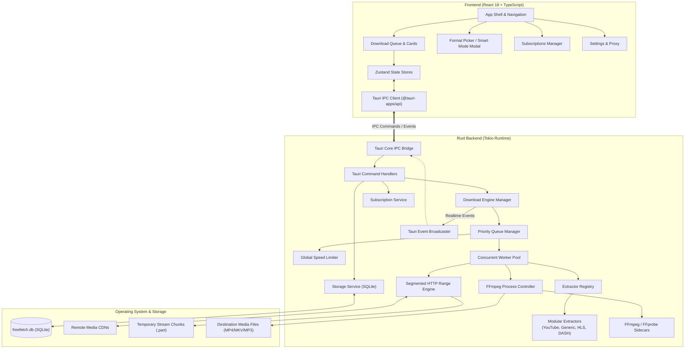
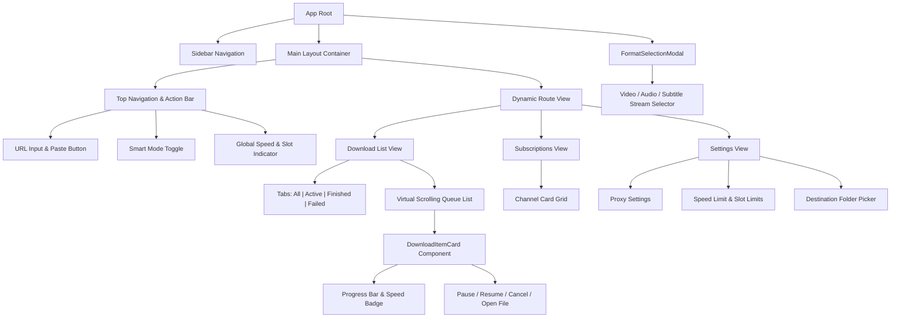
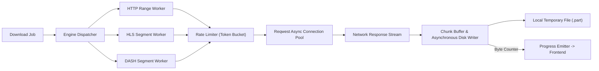
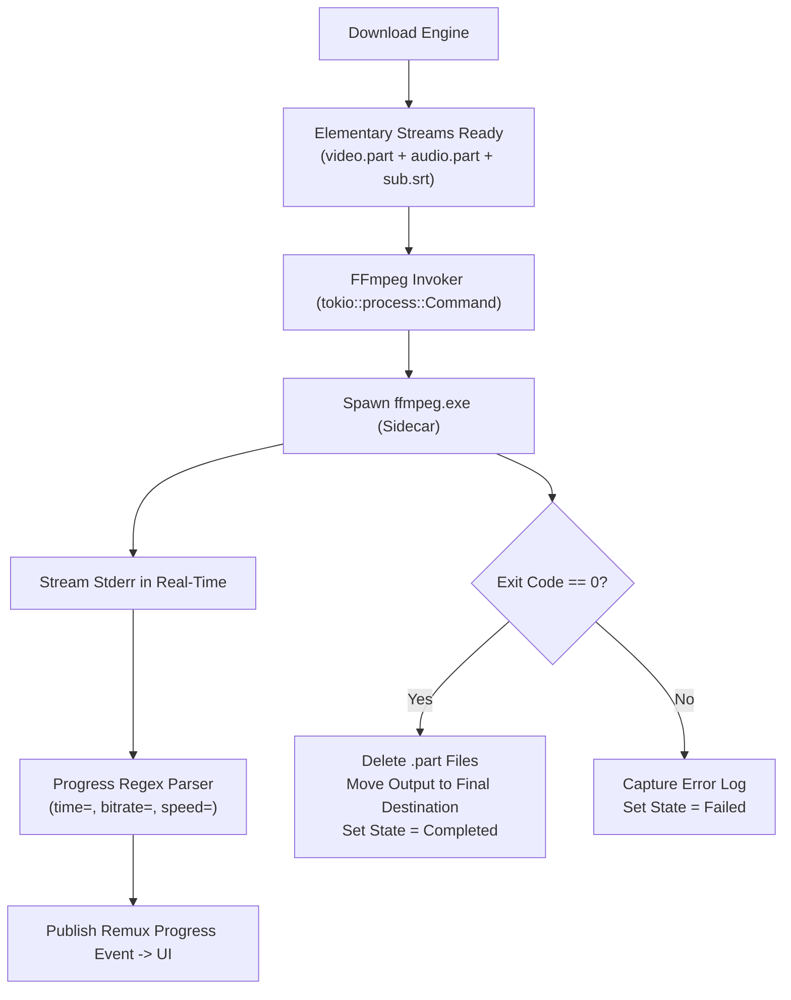
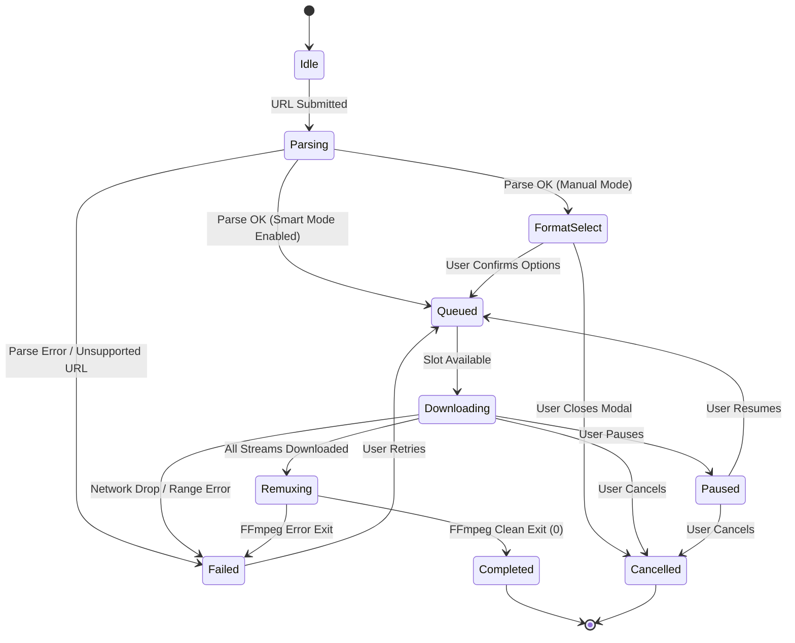

# FreeFetch: Technical Specification & Clean-Room System Architecture

**Document Version**: 1.0.0  
**Project Name**: FreeFetch  
**Target Platform**: Windows 10/11 x64, macOS (Apple Silicon / Intel), Linux x64  
**Implementation Methodology**: Clean-Room Design based on observable functional patterns of desktop media downloaders  
**License**: Open Source (GPLv3 or AGPLv3)

---

## 1. Product Feature Specification

FreeFetch is an independent, open-source desktop media downloader designed to deliver fast, reliable, high-fidelity media capture without bloat, telemetry, or adware.

### 1.1 Core Capabilities
1. **Multi-Quality Video Capture**:
   * Support for standard resolutions: SD (360p, 480p), HD (720p, 1080p FHD), Quad HD (1440p 2K), Ultra HD (2160p 4K), and 8K (4320p).
   * High Frame Rate support: 50fps, 60fps.
   * HDR (High Dynamic Range) stream preservation.
2. **Lossless Multiplexing (Remuxing)**:
   * Modern video platforms stream separated adaptive video (VP9, AV1, H.264) and audio (Opus, AAC) feeds.
   * FreeFetch downloads both elementary streams independently and merges them losslessly into a target container (`MP4` or `MKV`) using stream-copying without quality degradation.
3. **Pure Audio Extraction**:
   * Extraction of audio tracks from video URLs.
   * Output formats: Original audio stream copy (`M4A`, `Opus`, `WebM`) or transcoding to high-quality `MP3` (via LAME VBR/CBR up to 320 kbps), `FLAC`, and `AAC`.
4. **Subtitles & Closed Captions**:
   * Multi-language subtitle discovery.
   * Support for auto-generated captions and human-uploaded subtitles.
   * Formats: SubRip (`.srt`) and WebVTT (`.vtt`).
   * Choice of embedding subtitle tracks directly into `MKV`/`MP4` or saving as external sidecar files.
5. **Smart Mode (One-Click Downloads)**:
   * Global preset configuration defining: Preferred Resolution, Container (`MP4`/`MKV`/`MP3`), Subtitle preference, and Output Directory.
   * When enabled, pasting a URL bypasses the format selection dialog and starts downloading immediately.
6. **Batch & Playlist Ingestion**:
   * Parsing and downloading of entire playlists, albums, and channel video lists.
   * Interactive batch selector allowing selective check/uncheck of playlist items.
   * Sequential or bounded-concurrent batch execution.
7. **Channel Subscriptions & Auto-Sync**:
   * Users can track favorite channels or playlists.
   * Configurable background polling interval (e.g., hourly, daily).
   * Automatic queuing and downloading of new content with local deduplication.
8. **Network & Proxy Integration**:
   * Support for HTTP, SOCKS4, and SOCKS5 proxies with basic authentication.
   * Configurable global download speed limiter (token-bucket rate limiting).
   * Global maximum active download slots (1–10 concurrent jobs).
9. **In-App Authentication (Cookie Jar)**:
   * Clean-room session support: import cookies via Netscape `cookies.txt` or an embedded isolated WebView session to access private, age-gated, or subscriber-only content without storing passwords.
10. **Resilience & State Recovery**:
    * Resumable downloads for interrupted transfers using HTTP Range requests.
    * Persistent SQLite database tracking every download, file location, and progress state.

---

## 2. System Architecture

FreeFetch uses a high-performance, modular desktop architecture leveraging **Tauri v2** with a **Rust** backend engine and a **React + TypeScript** user interface.



### Architectural Principles
* **Zero UI Lag**: All networking, manifest parsing, disk I/O, and media processing run on the multi-threaded Tokio async runtime. The UI thread only renders updates.
* **Separation of Concerns**: Extractor modules only parse metadata and stream manifests; they do not handle downloading. The download engine only retrieves byte ranges; it does not parse site HTML.
* **Streamlined Distribution**: Tauri leverages the OS-native webview (WebView2 on Windows, WebKitGTK on Linux, WebKit on macOS), keeping total application binary size under 30 MB (excluding FFmpeg sidecars).

---

## 3. Backend Module Architecture (Rust)

The Rust backend is structured into distinct, decoupled crates/modules within the `src-tauri` workspace:

```
src-tauri/
├── src/
│   ├── main.rs                 # Tauri application bootstrap
│   ├── lib.rs                  # Module declarations and state setup
│   ├── core/
│   │   ├── config.rs           # Application configuration & user settings
│   │   ├── error.rs            # Typed error definitions (thiserror)
│   │   └── types.rs            # Shared domain primitives (MediaId, Quality, etc.)
│   ├── storage/
│   │   ├── mod.rs              # Database connection pool manager (r2d2_sqlite / sqlx)
│   │   ├── migrations.rs       # Embedded SQLite migration scripts
│   │   └── repository.rs       # CRUD operations for downloads, subscriptions, cookies
│   ├── extractor/
│   │   ├── mod.rs              # Extractor trait & factory registry
│   │   ├── context.rs          # ExtractionContext (cookies, proxy, HTTP client)
│   │   ├── models.rs           # MediaMetadata, StreamInfo, SubtitleTrack
│   │   └── implementations/    # Site-specific extraction implementations
│   │       ├── youtube.rs      # Innertube API clean-room extractor
│   │       ├── generic.rs      # HTML5 open-graph & direct video extractor
│   │       └── manifest.rs     # Generic HLS / DASH URL extractor
│   ├── engine/
│   │   ├── mod.rs              # Download engine orchestration
│   │   ├── queue.rs            # Bounded priority queue & job scheduler
│   │   ├── worker.rs           # Download task execution loop
│   │   ├── chunk_downloader.rs # HTTP Range chunked downloader with resume
│   │   ├── hls_downloader.rs   # M3U8 segment pipeline
│   │   ├── dash_downloader.rs  # MPD segment pipeline
│   │   ├── rate_limiter.rs     # Token-bucket bandwidth throttling
│   │   └── state.rs            # Download state machine & transition rules
│   ├── media/
│   │   ├── mod.rs              # Media utilities
│   │   ├── ffmpeg.rs           # FFmpeg sidecar process spawner & progress parser
│   │   └── probe.rs            # FFprobe stream analyzer
│   ├── service/
│   │   ├── subscription.rs     # Background cron/interval channel polling
│   │   └── clipboard.rs        # Optional OS clipboard monitoring service
│   └── ipc/
│       ├── mod.rs              # Tauri IPC registration
│       ├── commands.rs         # Invocable frontend commands
│       └── events.rs           # Outbound progress and state events
```

---

## 4. Frontend Component Architecture (React + TypeScript)

The frontend is constructed using **React 18**, **TypeScript**, **Tailwind CSS**, and **Zustand** for predictable state management.



### Key Frontend State Stores (`src/stores/`)
1. `useDownloadStore`: Manages array of download jobs, active progress maps, filter states, and active selections.
2. `useSettingsStore`: Manages output folder, concurrency limits, speed limit, proxy settings, and dark/light theme.
3. `useSmartModeStore`: Manages Smart Mode enabled flag, target container, resolution preference, and subtitle auto-download rules.
4. `useSubscriptionStore`: Manages registered channel feeds, update frequencies, and auto-download criteria.

---

## 5. Download-Engine Architecture

The download engine must handle high throughput without saturating disk I/O or blocking the Tokio worker threads.



### 5.1 Range Request Chunking Strategy
* For static/direct files or HTTP streams supporting `Accept-Ranges: bytes`, the engine checks `Content-Length`.
* Large streams are partitioned into concurrent slice chunks (e.g., 4 chunks of `N / 4` bytes).
* Each chunk worker issues an independent `Range: bytes=start-end` request and streams directly into pre-allocated positions in a `.part` file using `tokio::fs::File` with `seek`.
* If a connection drops, only the uncompleted chunk is retried, guaranteeing resumability.

---

## 6. Extractor Abstraction

To support multiple platforms cleanly without coupling site scrapers to the download engine, an extensible Rust trait abstraction is used:

```rust
use async_trait::async_trait;
use url::Url;
use crate::core::error::ExtractorError;
use crate::extractor::models::{MediaMetadata, StreamManifest};

pub struct ExtractionContext {
    pub client: reqwest::Client,
    pub cookies: Option<String>,
    pub user_agent: String,
    pub proxy: Option<String>,
}

#[async_trait]
pub trait Extractor: Send + Sync {
    /// Unique identifier for the extractor (e.g., "youtube", "generic")
    fn name(&self) -> &'static str;

    /// Evaluates if the URL matches this extractor's domain rules
    fn can_handle(&self, url: &Url) -> bool;

    /// Performs network extraction and returns normalized media metadata and available streams
    async fn extract(
        &self,
        url: &Url,
        ctx: &ExtractionContext,
    ) -> Result<(MediaMetadata, StreamManifest), ExtractorError>;
}
```

### Extractor Registry Pattern
* An `ExtractorRegistry` maintains a priority list of extractors:
  1. Specific platform extractors (e.g., `YoutubeExtractor`, `VimeoExtractor`, `BilibiliExtractor`).
  2. Generic manifest extractors (`HlsExtractor` for `.m3u8`, `DashExtractor` for `.mpd`).
  3. Fallback `GenericHtmlExtractor` (scans OpenGraph tags `<meta property="og:video">`, `<video src>` tags).

---

## 7. HLS and DASH Architecture

Streaming platforms use adaptive bitrate streaming protocols. FreeFetch implements dedicated parsing and segment fetching pipelines:

### 7.1 HLS Pipeline (HTTP Live Streaming)
1. **Manifest Parse**: Parse master `.m3u8` playlist using `m3u8-rs` to list media playlists with corresponding bandwidths and resolutions.
2. **Variant Selection**: Select the user's preferred resolution media playlist.
3. **Segment Enumeration**: Parse `#EXTINF` segment URLs and byte ranges.
4. **Download Execution**: Sequential or bounded-parallel (e.g., 3 concurrent segments) HTTP requests.
5. **Decryption (if required)**: Handle standard `#EXT-X-KEY` AES-128 encryption by retrieving the public initialization vector and key.
6. **Assembly**: Concat MPEG-TS or fragmented MP4 chunks directly into the temporary destination file.

### 7.2 DASH Pipeline (Dynamic Adaptive Streaming over HTTP)
1. **MPD Parse**: Parse XML manifest using `quick-xml`.
2. **AdaptationSet Traversal**: Locate separate `AdaptationSet` for video (e.g., `mimeType="video/mp4"`, codecs: `avc1`, `vp9`, `av01`) and audio (`mimeType="audio/mp4"`, codecs: `mp4a`, `opus`).
3. **Segment Timeline Resolution**: Resolve `$Number$` or `$Time$` segment templates using `SegmentTemplate` and `SegmentTimeline`.
4. **Initialization Chunk**: Retrieve `Initialization` chunk containing file headers (ftyp, moov boxes).
5. **Fragment Retrieval**: Stream sequential `Media` chunks and append to separate temporary audio/video `.part` files.

---

## 8. FFmpeg Integration Architecture

FreeFetch integrates FFmpeg as an external, isolated sidecar process. This isolates video decoding/encoding stability from the application process and ensures compliance with LGPL/GPL license boundaries.



### Standard Command Templates
1. **Lossless Remux (Video + Audio -> MP4)**:
   ```bash
   ffmpeg -y -i "temp_video.mp4" -i "temp_audio.m4a" -c copy -map 0:v:0 -map 1:a:0 -movflags +faststart "output.mp4"
   ```
2. **Lossless Remux with Embedded Subtitles (MKV)**:
   ```bash
   ffmpeg -y -i "temp_video.mp4" -i "temp_audio.m4a" -i "sub_en.srt" -c copy -map 0:v:0 -map 1:a:0 -map 2:s:0 -metadata:s:s:0 language=eng "output.mkv"
   ```
3. **Audio Transcoding (Video/Audio Stream -> MP3)**:
   ```bash
   ffmpeg -y -i "temp_audio.m4a" -vn -c:a libmp3lame -q:a 2 "output.mp3"
   ```

---

## 9. SQLite Schema

FreeFetch stores state in an embedded SQLite database (`freefetch.db`) using WAL (Write-Ahead Logging) mode for concurrent read/write stability:

```sql
PRAGMA journal_mode = WAL;
PRAGMA foreign_keys = ON;
PRAGMA synchronous = NORMAL;

-- Application Settings Key-Value Store
CREATE TABLE settings (
    key TEXT PRIMARY KEY,
    value TEXT NOT NULL
) WITHOUT ROWID;

-- Download Queue and History
CREATE TABLE downloads (
    id TEXT PRIMARY KEY,                   -- UUID v4
    source_url TEXT NOT NULL,
    service_name TEXT NOT NULL,            -- e.g. 'youtube', 'vimeo'
    title TEXT NOT NULL,
    duration INTEGER NOT NULL DEFAULT 0,   -- Duration in seconds
    thumbnail_url TEXT,
    destination_path TEXT NOT NULL,
    container TEXT NOT NULL,               -- 'mp4', 'mkv', 'mp3', etc.
    quality_label TEXT NOT NULL,           -- '1080p60', '4K', etc.
    total_bytes INTEGER DEFAULT 0,
    downloaded_bytes INTEGER DEFAULT 0,
    status TEXT NOT NULL,                  -- 'queued', 'downloading', 'remuxing', 'completed', 'failed', 'paused'
    error_message TEXT,
    created_at INTEGER NOT NULL,           -- Unix timestamp
    completed_at INTEGER
);

-- Elementary Streams Tracking per Download
CREATE TABLE download_streams (
    id TEXT PRIMARY KEY,                   -- UUID v4
    download_id TEXT NOT NULL,
    stream_type TEXT NOT NULL,             -- 'video', 'audio', 'subtitle'
    format_id TEXT NOT NULL,               -- Site-specific format ID
    codec TEXT,
    resolution TEXT,
    bitrate INTEGER,
    temp_file_path TEXT NOT NULL,
    total_bytes INTEGER DEFAULT 0,
    downloaded_bytes INTEGER DEFAULT 0,
    is_finished INTEGER DEFAULT 0,
    FOREIGN KEY(download_id) REFERENCES downloads(id) ON DELETE CASCADE
);

-- Subtitles
CREATE TABLE download_subtitles (
    id TEXT PRIMARY KEY,
    download_id TEXT NOT NULL,
    language_code TEXT NOT NULL,           -- 'en', 'es', etc.
    language_name TEXT NOT NULL,
    is_auto_generated INTEGER DEFAULT 0,
    output_path TEXT NOT NULL,
    is_embedded INTEGER DEFAULT 0,
    FOREIGN KEY(download_id) REFERENCES downloads(id) ON DELETE CASCADE
);

-- Channel and Playlist Subscriptions
CREATE TABLE subscriptions (
    id TEXT PRIMARY KEY,                   -- UUID v4
    query_url TEXT NOT NULL UNIQUE,
    service_name TEXT NOT NULL,
    title TEXT NOT NULL,
    thumbnail_url TEXT,
    poll_interval_sec INTEGER DEFAULT 86400,
    last_polled_at INTEGER,
    auto_download INTEGER DEFAULT 1,
    preferred_quality TEXT DEFAULT '1080p',
    preferred_container TEXT DEFAULT 'mp4',
    download_directory TEXT NOT NULL,
    created_at INTEGER NOT NULL
);

-- Download History for Subscriptions (Deduplication Log)
CREATE TABLE subscription_history (
    subscription_id TEXT NOT NULL,
    media_uid TEXT NOT NULL,               -- Remote platform video ID
    downloaded_at INTEGER NOT NULL,
    PRIMARY KEY(subscription_id, media_uid),
    FOREIGN KEY(subscription_id) REFERENCES subscriptions(id) ON DELETE CASCADE
) WITHOUT ROWID;

-- Indices for performance
CREATE INDEX idx_downloads_status ON downloads(status);
CREATE INDEX idx_downloads_created_at ON downloads(created_at DESC);
CREATE INDEX idx_download_streams_download_id ON download_streams(download_id);
```

---

## 10. Download State Machine



### State Machine Rules
1. **Atomic Transitions**: State updates persist to SQLite before publishing IPC events to the UI.
2. **Crash Resilience**: On application restart, any download in `Downloading` or `Remuxing` state transitions to `Paused` with existing partial files preserved.
3. **Cancellation Cleanup**: Moving to `Cancelled` or deleting a task unlinks all temporary `.part` files immediately.

---

## 11. Queue Architecture

The queue manager balances CPU, disk I/O, and network bandwidth:

* **Concurrency Limits**:
  * Default: **3 active download jobs**.
  * Configurable range: **1 to 10 active jobs**.
* **Bandwidth Throttler**:
  * Global token bucket implemented via `governor` crate.
  * When a speed limit is specified (e.g., 5 MB/s), chunks request tokens before reading from the network socket.
* **Worker Execution Lifecycle**:
  ```rust
  // Conceptual queue execution loop
  while let Some(job) = queue.next_queued_job().await {
      let permit = semaphore.clone().acquire_owned().await.unwrap();
      tokio::spawn(async move {
          let _permit = permit;
          run_download_task(job).await;
      });
  }
  ```

---

## 12. Error-Handling Strategy

Errors are strongly typed using `thiserror` and categorized for user readability:

```rust
#[derive(thiserror::Error, Debug)]
pub enum FreeFetchError {
    #[error("Network connection failed: {0}")]
    Network(#[from] reqwest::Error),

    #[error("Extractor error for {service}: {message}")]
    Extractor { service: String, message: String },

    #[error("HTTP range request rejected by host (Code {status})")]
    HttpRangeNotSupported { status: u16 },

    #[error("Insufficient disk space at destination: required {required_mb} MB, available {available_mb} MB")]
    DiskSpace { required_mb: u64, available_mb: u64 },

    #[error("FFmpeg remuxing process failed with exit code {code}: {log}")]
    RemuxFailed { code: i32, log: String },

    #[error("Database error: {0}")]
    Database(#[from] rusqlite::Error),

    #[error("Task was cancelled by user")]
    Cancelled,
}
```

* **Retry Strategy**: Transient network errors (timeouts, 502/503/504) use exponential backoff: 3 retries at 2s, 4s, 8s. Permanent errors (404, 403 Forbidden) fail immediately without useless polling.

---

## 13. IPC/API Contract between Tauri and Frontend

Communication between the React UI and the Rust backend occurs over typed Tauri commands and asynchronous event streams.

### 13.1 Invocable Commands (Frontend -> Backend)

```typescript
// IPC Method Signatures
export interface FreeFetchAPI {
  // Parsing & Analysis
  parseUrl(url: string): Promise<ParseResult>;
  
  // Job Lifecycle
  startDownload(params: StartDownloadParams): Promise<string>; // Returns download ID
  pauseDownload(id: string): Promise<void>;
  resumeDownload(id: string): Promise<void>;
  cancelDownload(id: string): Promise<void>;
  deleteDownload(id: string, deleteFiles: boolean): Promise<void>;
  
  // Querying
  getDownloads(): Promise<DownloadRecord[]>;
  getSettings(): Promise<AppSettings>;
  updateSettings(settings: Partial<AppSettings>): Promise<void>;
  
  // Subscriptions
  getSubscriptions(): Promise<SubscriptionRecord[]>;
  addSubscription(url: string, rules: SubscriptionRules): Promise<SubscriptionRecord>;
  removeSubscription(id: string): Promise<void>;
  
  // System Integrations
  openDestinationFolder(path: string): Promise<void>;
}
```

### 13.2 Asynchronous Events (Backend -> Frontend)

```typescript
// Tauri Event Names
export const IPC_EVENTS = {
  DOWNLOAD_PROGRESS: "download-progress",
  DOWNLOAD_STATE_CHANGED: "download-state-changed",
  SUBSCRIPTION_SYNC: "subscription-sync-event",
} as const;

export interface DownloadProgressPayload {
  id: string;
  downloadedBytes: number;
  totalBytes: number;
  speedBytesPerSec: number;
  etaSeconds: number;
  progressPercent: number;
}

export interface DownloadStateChangedPayload {
  id: string;
  status: "queued" | "downloading" | "remuxing" | "completed" | "failed" | "paused";
  errorMessage?: string;
}
```

---

## 14. Project Directory Structure

```
freefetch/
├── package.json                    # Monorepo scripts & frontend dependencies
├── tsconfig.json                   # TypeScript configuration
├── vite.config.ts                  # Vite bundler configuration
├── src/                            # Frontend (React 18 + TypeScript)
│   ├── index.html
│   ├── main.tsx
│   ├── App.tsx
│   ├── api/
│   │   ├── ipc.ts                  # Typed Tauri invoke & listen wrappers
│   │   └── types.ts                # TypeScript mirrored models
│   ├── components/
│   │   ├── common/                 # Button, Input, Modal, Badge, ProgressBar
│   │   ├── layout/                 # Sidebar, Header, TitleBar
│   │   ├── queue/                  # DownloadCard, QueueList, FilterTabs
│   │   ├── modal/                  # FormatModal, SmartModeModal
│   │   └── settings/               # SettingsForm, ProxyConfig
│   ├── hooks/                      # useDownloadEvents, useClipboard
│   └── stores/                     # Zustand stores
│       ├── downloadStore.ts
│       ├── settingsStore.ts
│       └── smartModeStore.ts
└── src-tauri/                      # Backend (Rust + Tauri v2)
    ├── Cargo.toml                  # Rust dependencies
    ├── tauri.conf.json             # Tauri window, security, sidecar settings
    ├── icons/                      # App desktop icons
    ├── sidecars/                   # Bundled binaries
    │   ├── ffmpeg-x86_64-pc-windows-msvc.exe
    │   └── ffprobe-x86_64-pc-windows-msvc.exe
    └── src/                        # Rust backend implementation
```

---

## 15. v0.1 MVP Scope

The target for **v0.1 MVP** is a robust, functional desktop downloader verifying the full pipeline:
* [x] Tauri + React desktop window with native OS frame.
* [x] Paste URL from clipboard.
* [x] Clean-room YouTube single-video parser (resolutions up to 1080p and 4K).
* [x] Format modal showing resolution, FPS, container (MP4, MKV), and MP3 audio option.
* [x] HTTP chunked range downloader with `.part` file generation.
* [x] FFmpeg sidecar integration for merging video + audio into final MP4.
* [x] Real-time download progress bar, speed meter (MB/s), and ETA.
* [x] Persistent SQLite database recording download history across application restarts.
* [x] Open downloaded file / open destination folder button.

---

## 16. Roadmap (v0.2 – v0.5)

| Version | Focus Area | Milestone Deliverables |
| :--- | :--- | :--- |
| **v0.2** | **Batch & Subtitles** | Full playlist & channel video ingestion. Multi-language subtitle extraction (SRT/VTT) with embedding support. Smart Mode 1-click downloads. |
| **v0.3** | **Protocols & In-App Auth** | HLS (.m3u8) & DASH (.mpd) stream engines. In-app isolated WebView session for age-gated/private content cookie capture. SOCKS5/HTTP proxy support. |
| **v0.4** | **Automation & Power Tools** | Automatic channel subscriptions with background periodic sync. Global download speed throttle. Custom output file naming templates (`{title} - {resolution}`). |
| **v0.5** | **AI Stem Separation** | Modular AI stem separation pipeline (vocal vs accompaniment extraction) utilizing an open-source ONNX Runtime sidecar. |

---

## 17. Security Considerations

1. **Path Traversal & File Sanitization**:
   * Remote media titles can contain dangerous characters (`../`, `\`, `:`, `*`, `?`, `"`, `<`, `>`, `|`).
   * All filenames must pass through a strict sanitization function replacing invalid characters with underscores and capping lengths at 200 characters.
2. **Command Injection Prevention**:
   * Never execute shell strings (no `sh -c` or `cmd.exe /C`).
   * Pass all arguments to `tokio::process::Command` as individual slices:
     ```rust
     Command::new(ffmpeg_path).arg("-i").arg(&video_path).arg(&out_path)
     ```
3. **SSRF (Server-Side Request Forgery) & Local Network Protection**:
   * The extractor and downloader validate all URLs, rejecting non-HTTP/HTTPS schemes (e.g., `file://`, `ftp://`).
4. **Tauri Security Hardening**:
   * Strict Content Security Policy (CSP) blocking external scripts in the webview.
   * Scoped Tauri permissions ensuring the frontend can only invoke designated API commands.

---

## 18. Testing Strategy

1. **Unit Testing (Rust)**:
   * Extractor URL matching tests.
   * Range header math tests (start/end offsets for byte chunks).
   * State machine transition integrity tests.
   * Path sanitization edge-case tests.
2. **Integration Testing (Mock HTTP)**:
   * WireMock HTTP test harness simulating remote CDN range responses, simulating dropped connections, testing automatic resumption.
3. **FFmpeg Sidecar Tests**:
   * Verifying sidecar execution across sample dummy media clips.
   * Stderr progress parser tests covering variable output formats.
4. **End-to-End (E2E) UI Tests**:
   * Playwright / WebDriver testing against the Tauri frontend.
   * Verifying paste link, modal popup, queue insertion, and progress animation.
